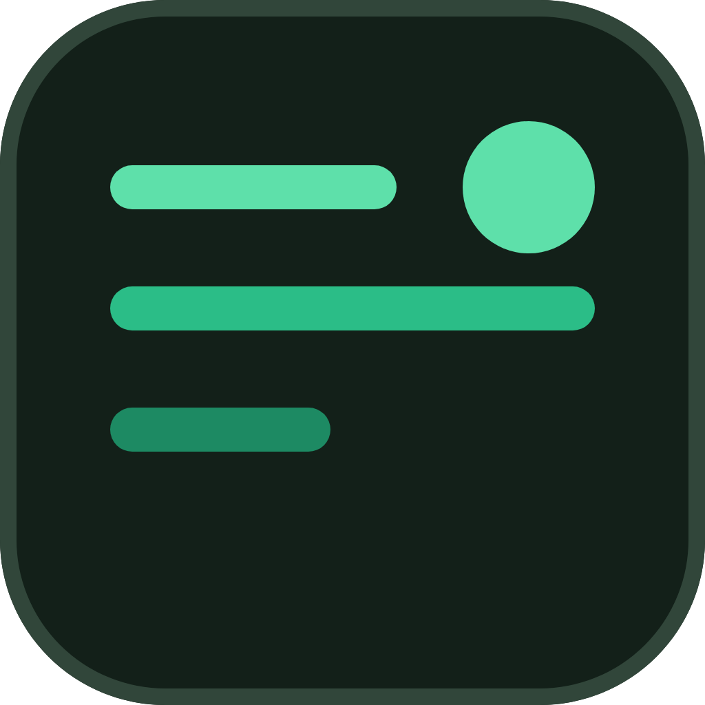
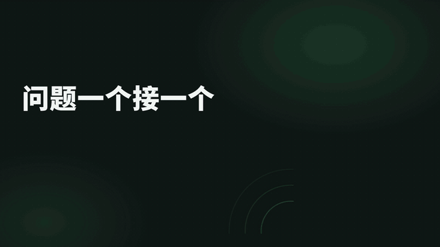
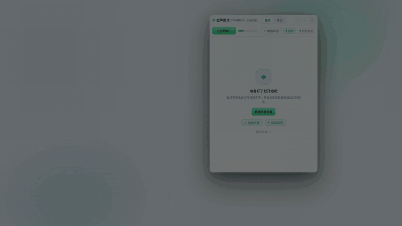
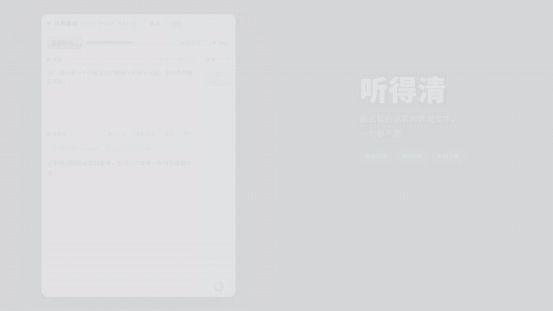
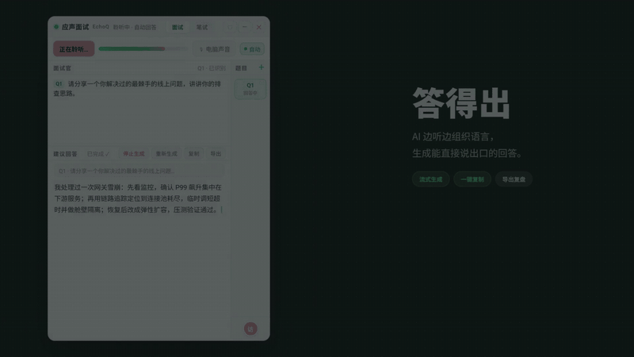
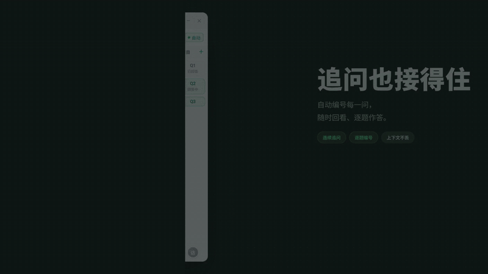

[简体中文](README.md) · [English](README.en.md)

<p align="center">
  
</p>

<h1 align="center">EchoQ Interview</h1>

<p align="center">
  A Windows desktop interview and written-test assistant: hear the interviewer's question and get an answer you can say out loud.
</p>

<p align="center">
  <a href="https://github.com/xhmooc/echoq-interview/releases/latest"></a>
  
  
</p>

| Interview demo | Written-test demo |
| --- | --- |
|  |  |

<p align="center">
  
</p>

A floating-window Windows assistant for interviews and written tests: it listens to the interviewer in real time, transcribes the speech, and streams a large-model answer written the way you would say it. In written-test mode, select a question on screen and get an answer after OCR.

- **Local offline speech recognition**: the llama.cpp engine is bundled in the installer. Download a Qwen3-ASR model inside the app on first run; after that, recognition runs fully offline
- **Two audio sources**: capture system audio (the interviewer's voice) or switch to the microphone for on-site interviews
- **Live answers**: a reply is generated automatically when a question is detected, or trigger one at any time with a shortcut
- **Written-test screenshots**: switch to "Written test" in the title bar, select a question, and get an OCR + model answer. Answers can appear in an always-on-top overlay or be pushed to a phone as a second screen
- **Floating window**: always on top, draggable, click-through, and optionally hidden from screen capture
- **Official access, works after sign-in**: answers are generated through the official relay. Sign in and it works — no endpoint or API key to fill in. Currently free to use
- **Bring your own key (advanced, optional)**: the LLM, speech recognition, and written-test vision can all point at your own OpenAI-compatible service. The default remains the official / local setup, and everything works without a key

## Feature highlights

| Hear it clearly: the interviewer's speech transcribed live | Answer it: AI streams a reply you can say out loud |
| --- | --- |
|  |  |

| Follow-ups included: numbered questions, context preserved | Written tests covered: select a question, get code solutions |
| --- | --- |
|  |  |

> Intended for personal study and technical interview preparation. Follow local laws and the interviewing organization's rules.

## The EchoQ family

EchoQ currently has two Windows desktop tools, maintained independently:

- **EchoQ Interview (应声面试)**: this repository, an interview and written-test assistant · [Website](https://job.echoq.cn/)
- **EchoQ Ops (应声运营)**: a content operations workspace for Xiaohongshu and other platforms · [Website](https://ops.echoq.cn/)

The server side of both products (accounts, timing and billing, cloud ASR and LLM relay, admin console) is closed source and not part of the public repository.

## Download

- [GitHub Releases](https://github.com/xhmooc/echoq-interview/releases/latest)
- [Official download page](https://job.echoq.cn/#download)

## Documentation

Each fact is maintained in one place only; other documents link to it:

| Topic | Single source |
| --- | --- |
| Product usage, installation, client configuration, privacy, build | This file ([README.md](README.md)) |
| Testing methods, VAD / segmentation / question-detection cases, latency breakdown, regression checklist | [TESTING.md](TESTING.md) |
| Server side (accounts, timing and billing, cloud relay, admin console) | Closed source, not shipped in this repository |
| Contributing, commit conventions, branches and review requirements | [CONTRIBUTING.md](CONTRIBUTING.md) |

## Quick start

### Option 1: download the installer (recommended)

Download from [GitHub Releases](https://github.com/xhmooc/echoq-interview/releases/latest) (or from the [official download page](https://job.echoq.cn/#download)):

- `yingsheng-<version>-setup.exe`: installer with a desktop shortcut
- `yingsheng-<version>-portable.exe`: portable build, double-click to run

On first launch a setup wizard walks you through four steps (you can also sign in with an official account first, using either email or phone):

1. **Speech recognition**: the default is "On-device recognition" (the engine is bundled). Pick a model size and click **Download on-device model** (small / medium / large, about 0.9 / 2.4 / 4.4 GB, recommended based on your memory, resumable). You can also switch to "Cloud recognition" and use it right after signing in, with no download. Advanced users can enter their own recognition service key in Settings
2. **Answer generation**: the default is official access. Sign in and it works — no endpoint or key needed. Currently free. You can also switch to "Custom key" and fill in your own OpenAI-compatible endpoint, key, and model name; requests bypass the official relay and do not consume official minutes
3. **Profession / role**: choose the closest role to add high-frequency domain terms for your field and improve recognition accuracy. Choose "General" if unsure
4. **Profile** (optional): paste your role and resume highlights for answers that fit your experience better

Click "Later" to skip; you can continue any time from **Settings** in the top-right corner. When everything is ready, go back to the main window and click **Start listening to the interviewer**.

### Option 2: run from source

Requires Node.js 18 or later.

```bash
npm install
npm start
```

On Windows you can also double-click `launch.vbs` (starts without a console window).

## Usage

### Shortcuts

| Action | Shortcut |
| --- | --- |
| Show / hide window | `Ctrl + Alt + H` |
| Answer now | `Ctrl + Alt + A` |
| Click-through (clicks pass to the app below) | `Ctrl + Alt + M` |
| Clear the transcript | `Ctrl + Alt + K` |
| Written test: select a question | `Alt + Shift + A` |
| Written test: show / hide the answer overlay | `Alt + Shift + S` |

All shortcuts can be changed under "Settings → Interface" and "Settings → Written test".

### Audio settings

- **Computer audio**: captures what is playing through the speakers / headphones, suited to online interviews. When capture starts, pick the window to share in the system dialog
- **Microphone**: suited to on-site interviews
- **Sensitivity / silence threshold**: raise sensitivity in noisy environments; increase the silence threshold when the speaker pauses often

### Speech recognition modes

- **On-device recognition**: offline, no extra recognition charges, low latency, recommended. The engine ships with the installer; on first use you only download a model (small / medium / large, sizes above)
- **Cloud recognition**: provided by the official account, available after signing in and starting the timer. No download, but requires a network connection; third-party transcription endpoints cannot be filled in here

If on-device recognition fails repeatedly, the app falls back to cloud automatically; if cloud recognition fails and the local engine is ready, it falls back to the device.

### Window and panes

The window can be resized from its edges, with a border and shadow so it is easy to see on the desktop.
Two draggable dividers are also available: the horizontal line between "Interviewer / Suggested answer" adjusts the height split, and the vertical line on the left of the question rail adjusts its width. Double-click a divider to restore the default; sizes are remembered.

### Written-test mode

Switch at any time with "Interview | Written test" in the title bar; the app remembers the last mode. Both modes share the same interface skeleton: the question rail on the right, the avatar at the bottom, and the toolbar at the top stay in place — only the left side changes between "transcript / answer" and "screenshot / answer".

- **Capture a question**: click "Capture question" or press `Alt + Shift + A`; the screen becomes a selection layer. Drag out the question area, then press Enter or click "Confirm". Supports multiple choice, code, formulas, and complex layouts.
- **Question numbers**: prefixes such as "18.", "3.", "(12)", or "Question 5" are recognized as the original paper's question number and shown on the chip and question card. If none is found, questions are numbered Q1 / Q2 in order.
- **Recognition engine**: uses the built-in Windows OCR by default (no download). Under "Settings → Written test → Recognition engine" you can switch to Indra OCR,
  which downloads a ~30 MB ONNX model automatically on first use (prefers `hf-mirror.com`, falls back to the source), then runs fully offline and is more accurate on printed Chinese.
  The model is stored in the user data directory; if Indra is unavailable the app falls back to Windows OCR. Indra model weights are used under the Datalab-modified OpenRAIL-M license.
- **Small screenshots**: small captures are upscaled first (up to 4×, target width 1600) and given a margin before OCR, avoiding "one character per line" results from tight crops.
  If the result is still fragmented, the app upscales once more and retries.
- **Recognition route**: the default is "Auto" — use cloud vision when local recognition is empty or looks like code / formulas. You can also fix it to local-only or cloud-first under "Settings → Written test".
- **Answer display**: by default both the desktop overlay and the phone second screen are used. The desktop overlay stays on top without stealing focus; `Alt + Shift + S` shows or hides it at any time.
- **Phone second screen**: clicking "Phone QR" in the toolbar opens a QR code directly (starting the second-screen service if needed). Connect the phone and computer to the same Wi-Fi and scan it to see answers on the phone only. An existing answer is pushed along; you can also connect before any answer exists. The service is reachable only on the local network and stops when the app closes or you click "Close".
- **Multiple questions in one screenshot**: when a screenshot contains several numbered questions, it is split into separate question cards automatically (missing numbers are filled in order) and answered one by one. Click the numbers on the right to switch.
- **Edit and re-answer**: if the recognized text is wrong, click the question text to edit it; saving regenerates the answer. "Answer again" keeps the question and answers it once more. The last 20 screenshots remain in the right rail as Q cards (thumbnail + recognized text); click an older card to return to that question. They are cleared when the app exits.
- **Timing**: time is counted only while recognizing a screenshot and generating an answer; it is settled as soon as the answer appears. Sitting in written-test mode does not keep consuming minutes.

> Full-screen limitation: for web-based tests the always-on-top overlay usually appears above a full-screen window. Some dedicated exam clients use exclusive full screen or actively take the foreground, and Windows does not allow ordinary apps to cover them — use the phone second screen in that case. The app does not steal focus, inject, or bypass anti-cheat.

### Version updates

- The app checks for a stable update once after launch (`/api/app/version`), or manually under "Settings → Advanced → Version update".
- When an update exists, the release notes and installer size are shown. Clicking "Update now" downloads to the system temp directory and starts the installer only after SHA256 verification; the current app closes before installation.
- If the server marks the update as mandatory (or the current version is below the minimum supported version), it cannot be skipped and must be installed before continuing.
- Versions dismissed with "Later" are not shown automatically again on the next launch; manual checks still see them.

## Data and privacy

With official access, account, balance, timing, and order data are stored on the official server; cloud recognition sends audio to the official server for transcription, and answers are generated by the upstream model through the official relay. In on-device mode, audio is processed only on your computer.

| Content | Location |
| --- | --- |
| Config (resume background, model size, etc.) | `%APPDATA%\interview-copilot-pro\config.json` (key fields encrypted with Electron `safeStorage`) |
| Sign-in credentials | `%APPDATA%\interview-copilot-pro\auth.json` (encrypted with Electron `safeStorage`) |
| Local engine | Bundled in the installer (`resources/engine`, only `llama-server.exe` and required DLLs). The bundled engine takes priority at startup; an old path in the config cannot override it. Older versions may still use `runtime\bin` |
| Speech recognition models | `%APPDATA%\interview-copilot-pro\runtime\models` |
| Written-test Indra OCR model | `%APPDATA%\interview-copilot-pro\models\indra\v1.1` (about 30 MB; safe to delete, re-downloaded when selected or verified again) |
| Logs | `%APPDATA%\interview-copilot-pro\logs` (daily `app-YYYY-MM-DD.log`, transcript text is not recorded) |

"Settings → Interface" can open the data and log directories directly.

- Official access uses the sign-in token for the relay. Key fields in the config (official key, custom LLM / recognition / vision keys) are encrypted with `safeStorage`; exported configs omit keys automatically
- With "Custom key", transcription, screenshots, and model requests go directly to your provider and bypass the official server; those costs are billed by your provider
- If the server is unreachable when signing out, pending credential revocations are queued and sent first on the next online launch
- "Hide from screen capture" is off by default and can be enabled in Settings. It relies on the system `SetWindowDisplayAffinity`; some screen recorders / sharing methods on Windows may still capture the window, so it cannot guarantee complete invisibility
- Transcript text is sent as context to the official relay for answer generation; diagnostic logs record only character count, sentence count, question count, and error codes
- Written-test screenshots are saved only to the system temp directory `%TEMP%\echoq-written\` and can be cleaned up after the app exits. Local OCR runs on your computer; screenshots are sent to the official server only when you choose cloud recognition or fall back to it automatically, and to your own endpoint when you choose a custom vision model

## How it works

```
main.js                  Electron main process: windows, shortcuts, IPC
preload.js               Safe API exposed via contextBridge
src/main/paths.js        User data directory, model file names, legacy config migration
src/main/config.js       Config read / write and defaults
src/main/assets.js       Model downloads (engine bundled, online fallback if missing): mirrors, resume, unzip, verify
src/main/asr.js          Local llama-server lifecycle + cloud transcription routing
src/main/llm.js          Official relay (OpenAI-compatible) streaming generation
src/main/auth.js         Sign-in, SMS, token storage
src/main/cloud.js        Read-only cache of cloud config / models / hotword libraries
src/main/orders.js       Plans, orders, and payment links
src/main/resume.js       Resume / outline document parsing
src/main/hardware.js     Hardware detection and model size recommendations
src/main/written.js      Written test: screenshot selection, multi-question split, local / cloud OCR, answer overlay
src/main/indra.js        Written test: Indra ONNX recognition (model download / verify + local inference)
src/main/phone.js        Written test: phone second screen (LAN HTTP + SSE + QR code)
src/main/logger.js       File logging
src/renderer/            UI: transcript, answers, written test, settings
src/renderer/capture.*   Written-test selection layer
src/renderer/answer.*    Written-test answer overlay
src/renderer/audio.js    System audio / microphone capture, VAD segmentation, WAV encoding
website/                 Website and account pages (static)
tools/check-asr.js       Command-line self-check: wav → transcription → answer
```

The server side (accounts, timing and billing, official relay, cloud ASR, and the admin console) is not open source and is not in this repository; the client accesses it through official APIs.

Local recognition runs through the bundled `llama-server.exe`: a complete WAV segment is transcribed via `input_audio` on `/v1/chat/completions`.

Where tools and runtime files come from:

- Engine: `tools/prepare-engine.js` copies it into `build/engine` at packaging time. The order is **reuse what exists locally first** (`IC_ENGINE_DIR`, `build/engine`, `release/win-unpacked/resources/engine`, both legacy runtime directories, the development machine's clipforge), and only if none is found does it download the fixed `b12096` build of `llama-*-bin-win-cpu-x64.zip`. The download is checked against a pinned SHA-256 and deleted with an error on mismatch. On networks in China, set `IC_LLAMA_MIRROR` (mirror prefix) or `IC_LLAMA_ZIP_URL` (full URL) to choose a source; mirror downloads are hash-checked too. Extraction keeps only `llama-server.exe` and its DLLs — `llama-cli`, `llama-quantize`, `llama-bench`, `llama-tts`, `llama-rpc-server`, and `ggml-rpc-server` never enter the installer
- Runtime engine: when the bundled engine exists it is used directly, without going online because of an old config path, version check, or verification failure. The online fallback runs only when the installer really lacks the engine, and it also honors `IC_LLAMA_MIRROR` / `IC_LLAMA_ZIP_URL`. You can also place the engine manually under `%APPDATA%\interview-copilot-pro\runtime\bin`, or point `IC_ENGINE_DIR` at an existing local directory when packaging
- Models: prefer `hf-mirror.com`, falling back to `huggingface.co`

## Development and build

```bash
npm start           # run in development
npm run check-asr -- <wav file>   # command-line self-check: transcription + answer
npm run prepare-engine            # prepare the bundled engine (run automatically by pack / dist)
npm run pack        # produce an unpacked directory (release/win-unpacked)
npm run dist        # produce the installer and portable exe (release/)
```

Before releasing, confirm whether the version really needs to change: only new features (+0.01) or major updates (+0.1) bump it. UI, copy, interaction, performance fixes, and rebuilds do not change the version number; the client and server stay in sync. See "Version rules" in [CONTRIBUTING.md](CONTRIBUTING.md) for the full checklist.

The first build on networks in China may stall while downloading the Electron distribution; set mirrors first:

```bash
set ELECTRON_MIRROR=https://npmmirror.com/mirrors/electron/
set ELECTRON_CUSTOM_DIR={{ version }}
set ELECTRON_BUILDER_BINARIES_MIRROR=https://npmmirror.com/mirrors/electron-builder-binaries/
npm run dist
```

Debug the renderer process:

```bash
npx electron . --remote-debugging-port=9221
```

## FAQ

**Downloads are slow or keep stopping?**
Downloads are resumable: clicking "Download" again after an interruption continues from the downloaded part. On networks in China, keep the built-in mirror enabled.

**Clicking "Start listening" does nothing the first time?**
The local engine takes 10–30 seconds to load for the first time. The app pre-warms it in the background after launch; if the engine is not ready when you click "Start listening", the start waits in a queue and timing begins after it is ready — no need to retry. You can also click "Pre-warm / self-check" in Settings.

**The port is already in use?**
Go to Settings → Speech recognition → Advanced, change the port from `8091` to another value (for example `8092`), and save.

**No computer audio is captured?**
Make sure "Listen to" is set to "Computer audio" and pick the screen / window to share in the system dialog when capture starts. If the interview app takes exclusive control of the sound card, you may need to allow app audio capture in the system settings.

**Do I need to download models again after switching computers?**
Models live in the user data directory and are not bundled with the app. After switching computers, click "Download on-device model" again; no manual path configuration is needed.

## Changelog

Release history and server deployment verification are maintained internally by the author and are not part of this repository.

## License

This project is licensed under the [MIT License](LICENSE).

The license covers only the client code and static website pages in this repository. The server side (accounts, timing and billing, cloud ASR and LLM relay, admin console) is closed-source software, is not part of this repository, and is not covered by this license. Product names, logos, and the EchoQ cloud services are not covered by this license.
