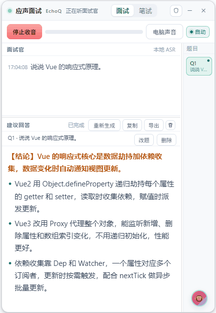
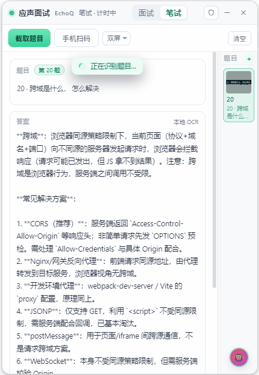

[简体中文](README.md) · [English](README.en.md)

<p align="center">
  
</p>

<h1 align="center">EchoQ Interview</h1>

<p align="center">By the time the interviewer finishes, the answer is already on screen.</p>

> Listens to the interviewer, transcribes in real time, and streams an answer you can say out loud. Capture system audio for online interviews, or switch to the microphone for on-site ones. In written-test mode, select a question and get an approach and code. The window stays on top, can be dragged or made click-through, and can be hidden from screen sharing (behavior depends on the OS and meeting app — test it on your own setup before relying on it). Intended for personal study and interview preparation; follow local laws and the interviewing organization's rules.

## Features

### Interview mode: hear the question, answer live

Captures system audio or the microphone and transcribes the interviewer locally. Answers are generated automatically when a question is detected, or on demand with `Ctrl+Alt+A`; answers are grouped by question number, and Q1 / Q2 on the right let you revisit them.



### Written-test mode: select a question, get an approach and code

Press `Alt+Shift+A` to select a question on screen; OCR plus the model produce an answer. Press `Alt+Shift+S` to show or hide the answer window. Works for algorithm tests, online assessments, and aptitude tests.



### Floating window: stays out of your way

Always on top and semi-transparent, draggable, optionally click-through. The control strip can be collapsed, and keyboard focus stays in your original app.

### Two audio sources

For online interviews, capture system audio — your own voice will not trigger it. For on-site or phone interviews, switch to the microphone.

### Phone screen

Push answers to a phone browser in real time while keeping only a small window on the desktop.

### Sign in, or bring your own key

Sign in with an EchoQ account and it works — no endpoint or API key needed. You can also point the LLM, speech recognition, and written-test vision at your own OpenAI-compatible service in Settings.

## Typical use

| Scenario | How |
| --- | --- |
| Technical interview | Interview mode with system audio and automatic answers |
| Phone / on-site interview | Interview mode with the microphone as the audio source |
| Algorithm test / online assessment | Written-test mode, select the question with `Alt+Shift+A` |
| Hard-to-read questions or diagrams | Select them in written-test mode and ask for an approach |
| Review | Copy or export the current answer and revisit it by question number |

## Quick start

1. **Install**: download from [Releases](https://github.com/xhmooc/echoq-interview/releases) — installer or portable build — or from the [official download page](https://job.echoq.cn/#download)
2. **Sign in**: open the app and sign in with an EchoQ account; answers are generated via the cloud, with no endpoint or key to configure
3. **Pick a mode**: in interview mode press "Start listening"; in written-test mode press `Alt+Shift+A` and select a question

On first use of local recognition, follow the in-app prompt to download the engine and model; after that, speech recognition runs fully offline. To use your own service, fill in an OpenAI-compatible endpoint and key under Settings → Models.

## Shortcuts

| Action | Shortcut |
| --- | --- |
| Show / hide window | `Ctrl+Alt+H` |
| Open lyrics overlay / back to main window | `Ctrl+Alt+O` |
| Reveal floating controls | `Ctrl+Alt+M` |
| Previous / next question | `Ctrl+Alt+Z` / `Ctrl+Alt+X` |
| Answer the current question | `Ctrl+Alt+A` |
| Clear the transcript | `Ctrl+Alt+K` |
| Written test: select a question | `Alt+Shift+A` |
| Written test: show / hide the answer window | `Alt+Shift+S` |

All shortcuts can be changed under Settings → Shortcuts.

## Troubleshooting

Check the error shown in the app first, then [open an issue](https://github.com/xhmooc/echoq-interview/issues/new) with the app version, Windows version, and the exact error text. Mask any personal information in screenshots.

You can also join the feedback group: EchoQ Interview Group 1, **337195606**.

## Run from source

Requires Node.js 18+ and Windows 10 / 11:

```bash
npm install
npm start
```

If the local engine or model is missing on first launch, follow the in-app prompt; you can also connect your own service in Settings.

## License

[MIT](LICENSE). Product names, logos, and the EchoQ cloud services are not covered by this license.
