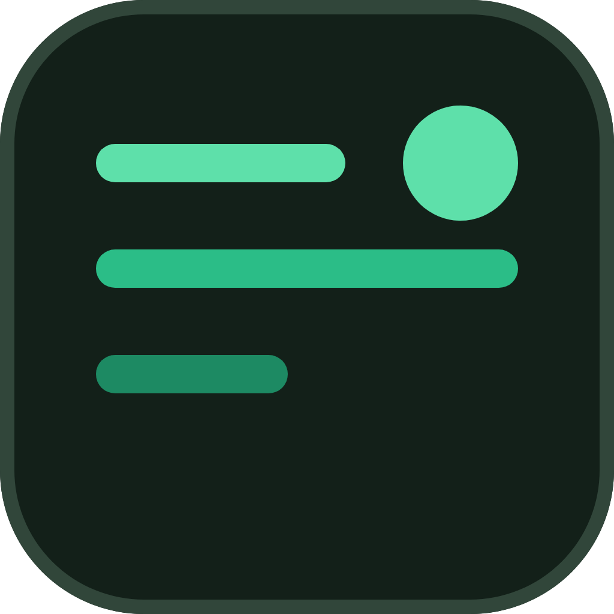
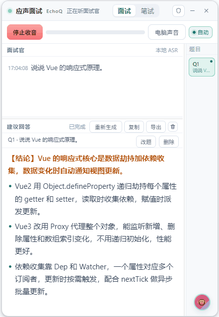
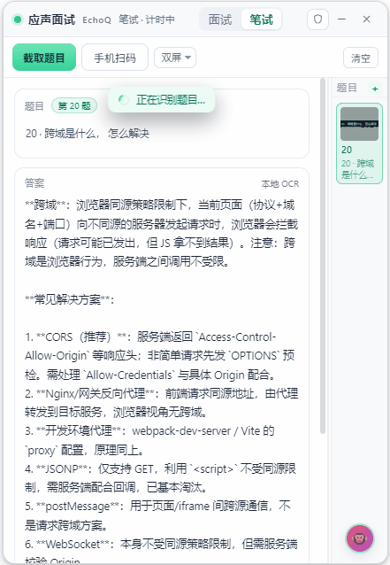
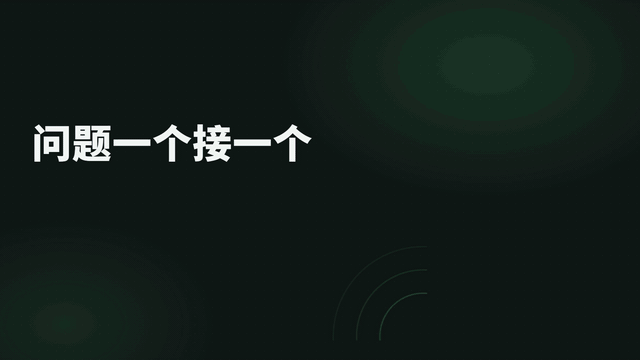
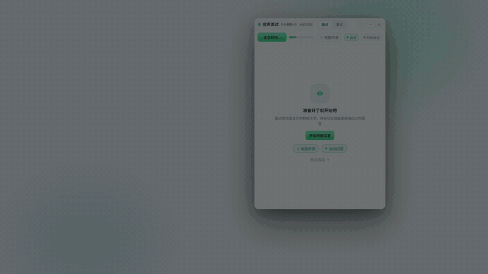
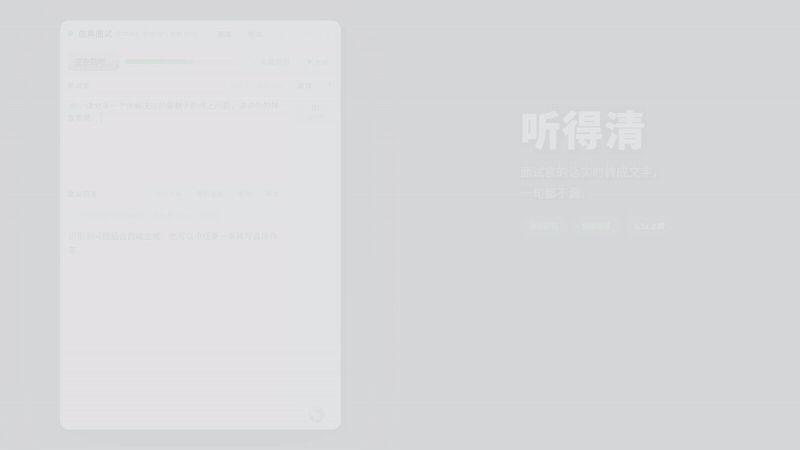
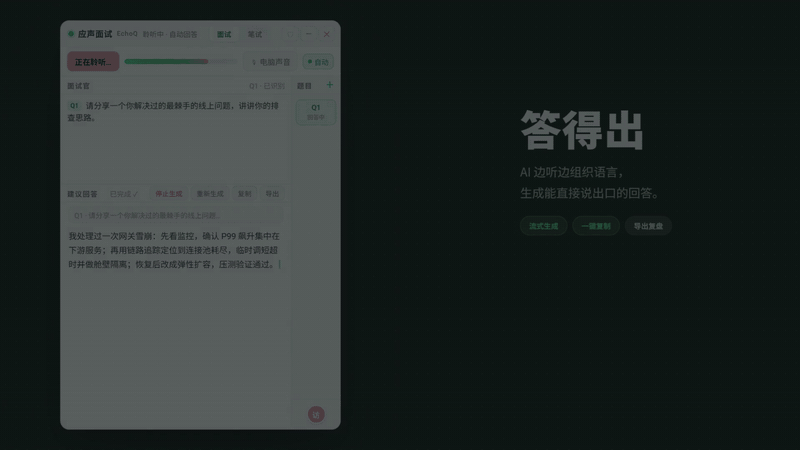
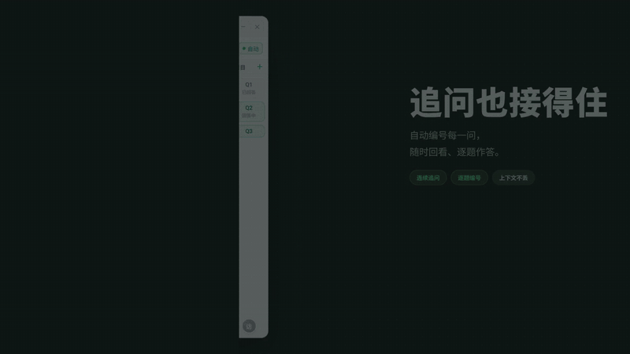

[简体中文](README.md) · [English](README.en.md)

<p align="center">
  
</p>

<h1 align="center">应声面试 · EchoQ-Interview</h1>

<p align="center">
  Windows 桌面面试 / 笔试助手：听清面试官的问题，给出可以直接说出口的回答。
</p>

<p align="center">
  <a href="https://github.com/xhmooc/echoq-interview/releases/latest"></a>
  
  
</p>

| 面试演示 | 笔试演示 |
| --- | --- |
|  |  |

<p align="center">
  
</p>

一个 Windows 桌面悬浮窗面试 / 笔试助手：实时听清面试官的问题，自动转成文字，并用大模型流式生成「可以直接说出口」的回答；笔试模式下框选题目截图，识别后生成答案。

- **本地离线语音识别**：安装包内置 llama.cpp 引擎，首次在应用内下载 Qwen3-ASR 模型，之后语音识别完全离线运行
- **两路收音**：可以直接抓取电脑声音（面试官的声音），也可以切到麦克风（现场面试）
- **实时回答**：识别到问题自动生成，也可以随时按快捷键手动作答
- **笔试截图答题**：标题栏切到「笔试」，框选题目即可 OCR + 大模型作答；答案可显示在置顶悬浮窗，也可推到手机副屏
- **悬浮窗设计**：置顶、可拖动、鼠标穿透、防录屏隐身
- **官方接入，登录即用**：回答由官方中转调用大模型生成，登录账号后自动生效，不需要填接口地址或 Key；当前免费使用
- **可自带 Key（高级，可选）**：大模型、语音识别、笔试视觉识别都可以改用自己接入的 OpenAI 兼容服务；默认仍是官方 / 本机方案，不填 Key 也能直接使用

## 功能速览

| 听得清：面试官的话实时转文字 | 答得出：AI 流式生成能直接说出口的回答 |
| --- | --- |
|  |  |

| 追问也接得住：逐题编号、上下文不丢 | 笔试也稳：框选题目，代码题直接给解法 |
| --- | --- |
|  |  |

> 仅用于个人学习与技术面试准备，请在符合当地法律与面试方规定的前提下使用。

## EchoQ 系列

EchoQ 目前有两款 Windows 桌面工具，分别独立维护：

- **应声面试（EchoQ Interview）**：本仓库，面试与笔试助手 · [官网](https://job.echoq.cn/)
- **应声运营（EchoQ Ops）**：面向小红书等内容平台的内容运营工作台 · [官网](https://ops.echoq.cn/)

两款产品的服务端（账号、计时计费、云端 ASR 与大模型中转、管理后台）均为闭源，不在公开仓库内。

## 下载

- [GitHub Releases](https://github.com/xhmooc/echoq-interview/releases/latest)
- [官网下载页](https://job.echoq.cn/#download)

## 文档分工

同一事实只在一个文件维护，其他位置只引用：

| 内容 | 唯一出处 |
| --- | --- |
| 产品使用、安装、客户端配置、隐私、构建 | 本文件（[README.md](README.md)） |
| 测试方法、VAD/断句/判题用例、延迟拆解、回归清单 | [TESTING.md](TESTING.md) |
| 服务端（账号、计时计费、云端中转、管理后台） | 闭源，不随本仓库提供 |
| 参与开发、提交规范、分支与评审要求 | [CONTRIBUTING.md](CONTRIBUTING.md) |

## 快速开始

### 方式一：直接下载安装包（推荐）

到 [GitHub Releases](https://github.com/xhmooc/echoq-interview/releases/latest) 下载（也可以在[官网下载页](https://job.echoq.cn/#download)下载）：

- `yingsheng-<版本>-setup.exe`：安装版，带桌面快捷方式
- `yingsheng-<版本>-portable.exe`：免安装，双击即用

首次启动会弹出初始化引导，按四步走（也可以先登录官方账号，邮箱或手机号均可）：

1. **语音识别**：默认「本机识别」（引擎已内置），选好模型档位后点 **下载本机识别模型**（小/中/大三档约 0.9 / 2.4 / 4.4 GB，按内存推荐，支持断点续传）；也可以切到「云端识别」，登录后直接用，无需下载；高级用户也可以在设置里填自己的识别服务 Key
2. **回答生成**：默认官方接入，登录账号后自动生效，不需要填接口或 Key；当前免费使用。也可以切到「自定义 Key」，填自己的 OpenAI 兼容地址、Key 和模型名，不经过官方、不扣官方时长
3. **职业 / 岗位**：选择最接近的岗位，会自动补充该岗位的高频专业词，提升识别准确率；不确定可以选「通用」
4. **个人资料**（可选）：粘上岗位和简历要点，回答会更贴合你的经历

点「稍后再说」可以跳过，之后在右上角「设置」里随时继续配置。全部就绪后回到主界面点 **开始听面试官**。

### 方式二：从源码运行

需要 Node.js 18 及以上版本。

```bash
npm install
npm start
```

Windows 下也可以双击 `launch.vbs`（会隐藏控制台窗口启动）。

## 使用说明

### 快捷键

| 功能 | 快捷键 |
| --- | --- |
| 显示 / 隐藏窗口 | `Ctrl + Alt + H` |
| 立即作答 | `Ctrl + Alt + A` |
| 鼠标穿透（点击不拦截操作） | `Ctrl + Alt + M` |
| 清空记录 | `Ctrl + Alt + K` |
| 笔试：框选题目 | `Alt + Shift + A` |
| 笔试：显示 / 隐藏答案悬浮窗 | `Alt + Shift + S` |

快捷键都可以在「设置 → 界面」和「设置 → 笔试」里改成自己顺手的组合。

### 收音设置

- **电脑声音**：抓取扬声器 / 耳机里播放的声音，适合线上面试。开始收音时按系统提示选择要共享的窗口即可
- **麦克风**：适合线下面试
- **灵敏度 / 断句静音**：环境嘈杂时调高灵敏度，说话停顿多时调大断句静音

### 语音识别模式

- **本机识别**：离线、识别不额外计费、延迟低，推荐。引擎随安装包内置，首次只需下载模型（小/中/大三档，体积见上方快速开始）
- **云端识别**：由官方账号提供，登录并开始计时后使用，免下载但需要联网；不提供自填第三方转写接口

本机识别连续失败会自动转云端；云端识别失败时，若本机已就绪会自动回退本机。

### 窗口与分栏

窗口本身可以拉边调整大小，四周有描边和投影，贴在桌面上能看清边界。
界面里还有两条可拖动的分隔线：「面试官 / 建议回答」之间的横线调整上下高度，题目栏左侧的竖线调整题目栏宽度；双击分隔线恢复默认，尺寸会记住。

### 笔试模式

标题栏的「面试 | 笔试」可以随时切换，切换后会记住上次停留的模式。两种模式共用同一个界面骨架，右侧题目栏、底部头像和顶部工具栏的位置不变，只是左侧内容在「转写 / 回答」和「截图 / 答案」之间切换。

- **截取题目**：点「截取题目」或按 `Alt + Shift + A`，屏幕会变成框选层；拖出题目区域后按 Enter 或点「确定」。支持选择题、代码、公式和复杂排版。
- **题号识别**：截图里带「18.」「3、」「（12）」「第 5 题」这类前缀时会自动识别原卷题号，题目栏芯片和题目卡片直接显示题号；识别不到时按 Q1/Q2 顺序编号。
- **识别引擎**：默认用 Windows 自带 OCR（无需下载）；「设置 → 笔试 → 识别引擎」可切到 Indra OCR，
  首次自动下载约 30 MB ONNX 模型（优先走 `hf-mirror.com`，失败回源），之后完全离线识别，中文印刷体更准。
  模型放在用户数据目录，Indra 不可用时会自动退回 Windows OCR。Indra 模型权重按 Datalab 修改版 OpenRAIL-M 许可使用。
- **小图处理**：截图偏小时会先放大（最多 4 倍、目标宽度 1600）再补一圈留白给 OCR，避免紧贴文字裁切导致「一个字一行」；
  万一返回的还是碎片结果，会自动放大重试一次。
- **识别路线**：默认「自动」——本地识别为空或像代码 / 公式时再走云端视觉；也可以在「设置 → 笔试」里固定为只走本地或优先云端。
- **答案显示**：默认同时显示电脑悬浮窗和手机副屏。电脑悬浮窗置顶、不抢焦点，`Alt + Shift + S` 可随时显示 / 隐藏。
- **手机副屏**：点工具栏「手机扫码」会直接弹出二维码（副屏服务没开时会自动启动），手机和电脑连同一 Wi-Fi 后扫码即可在手机上只看答案；当前已有答案时会顺带推送过去，没有答案也能先连上。服务只在本机局域网可访问，关闭应用或点「关闭」立即失效。
- **多题截图**：一张截图里有多道带题号的题时，会按题号自动拆成多张题目卡（题号漏认也能按顺序补齐），逐题依次作答；点右侧题号切换查看。
- **改题重答**：识别文字有错时直接点题目文字进入编辑，改完保存会重新生成答案；「重新回答」保持题目不变再答一次。最近 20 次截图会以 Q 卡留在右侧题目栏（缩略图 + 识别文字），点旧卡可切回之前的题目，退出应用即清空。
- **计时方式**：只在截图识别和生成答案期间计时，答案出来后立即结算；停在笔试界面不会一直扣时长。

> 全屏限制说明：网页笔试通常能把置顶悬浮窗显示在全屏窗口之上；部分专用考试客户端使用独占全屏或主动抢占前台，Windows 不允许普通应用强行覆盖，这时请改用手机副屏。应用不会做抢焦点、注入或绕过反作弊的行为。

### 版本更新

- 应用启动后会自动检查一次稳定版更新（`/api/app/version`），也可以在「设置 → 高级 → 版本更新」手动检查。
- 有新版本时会显示更新内容和安装包大小；点「立即更新」后下载到系统临时目录，校验 SHA256 通过才启动安装程序，安装前会关闭当前应用。
- 服务端标记为强制更新（或当前版本低于最低支持版本）时，不能跳过，必须更新后才能继续使用。
- 点过「稍后」的版本不会在下次启动时重复弹出；手动检查仍能看到。

## 数据与隐私

使用官方接入时，账号、余额、计时与订单数据保存在官方服务端；云端识别会把音频发送到官方服务端转写，回答则由官方中转调用上游大模型生成。本机识别模式下音频只在本机处理。

| 内容 | 位置 |
| --- | --- |
| 配置（简历背景、识别模型档位等） | `%APPDATA%\interview-copilot-pro\config.json`（Key 字段用 Electron `safeStorage` 加密） |
| 登录凭证 | `%APPDATA%\interview-copilot-pro\auth.json`（用 Electron `safeStorage` 加密） |
| 本地引擎 | 随安装包内置（`resources/engine`，只含 `llama-server.exe` 与运行所需 dll）。启动时内置引擎优先，配置里的旧路径不会覆盖它；旧版可能仍在 `runtime\bin` |
| 语音识别模型 | `%APPDATA%\interview-copilot-pro\runtime\models` |
| 笔试 Indra OCR 模型 | `%APPDATA%\interview-copilot-pro\models\indra\v1.1`（约 30 MB，可删；删除后再次选择 / 校验会自动重下） |
| 日志 | `%APPDATA%\interview-copilot-pro\logs`（按天生成 `app-YYYY-MM-DD.log`，不记录转写原文） |

设置 → 界面 里可以直接打开数据目录和日志目录。

- 官方接入用登录 token 调用中转；配置里的 Key 字段（官方 Key、自定义大模型 / 识别 / 视觉 Key）都用 `safeStorage` 加密，导出的配置会自动剔除 Key
- 选择「自定义 Key」后，转写、截图和大模型请求会直接发到你填写的服务商，不经过官方服务端；对应费用由你的服务商结算
- 退出登录时如果连不上服务端，待吊销的登录凭证会排队，下次联网启动时优先补发
- 「防录屏隐身」默认关闭，可在设置里按需开启；它依赖系统 `SetWindowDisplayAffinity`，Windows 下部分录屏 / 共享方式仍可能捕获窗口，不能保证完全隐身
- 转写文本会作为上下文发给官方中转的大模型服务，用于生成回答；诊断日志只记录字符数、句数、问句数和错误码
- 笔试截图只保存到系统临时目录 `%TEMP%\echoq-written\`，退出应用后可自行清理；本地 OCR 在电脑上完成，只有在你选择云端识别或自动回退云端时，截图才会发送到官方服务端；选择自定义视觉模型时改为发送到你填写的接口

## 工作原理

```
main.js                  Electron 主进程：窗口、快捷键、IPC
preload.js               contextBridge 暴露的安全 API
src/main/paths.js        用户数据目录、模型文件名、旧配置迁移
src/main/config.js       配置读写与默认值
src/main/assets.js       模型下载（引擎随包内置，缺失时在线兜底）：镜像、断点续传、解压、校验
src/main/asr.js          本地 llama-server 生命周期 + 云端转写路由
src/main/llm.js          官方中转（OpenAI 兼容）流式生成
src/main/auth.js         登录、短信、token 存储
src/main/cloud.js        云端配置 / 模型 / 热词库的只读缓存
src/main/orders.js       套餐、下单与支付链接
src/main/resume.js       简历 / 大纲文档解析
src/main/hardware.js     硬件检测与模型档位建议
src/main/written.js      笔试：框选截图、多题拆分、本地 / 云端 OCR、答案悬浮窗
src/main/indra.js        笔试：Indra ONNX 识别（模型下载 / 校验 + 本地推理）
src/main/phone.js        笔试：手机副屏（局域网 HTTP + SSE + 二维码）
src/main/logger.js       文件日志
src/renderer/            界面：转写、回答、笔试、设置页
src/renderer/capture.*   笔试框选层
src/renderer/answer.*    笔试答案悬浮窗
src/renderer/audio.js    系统声音 / 麦克风采集、VAD 断句、WAV 编码
website/                 官网与账号页（静态）
tools/check-asr.js       命令行自检：wav → 转写 → 回答
```

服务端（账号、计时计费、官方中转、云端 ASR 与管理后台）不开源，不在本仓库内；客户端通过官方接口访问。

本地识别链路：由内置 `llama-server.exe` 完成，整段 WAV 通过 `/v1/chat/completions` 的 `input_audio` 转写。

工具与运行文件来源：

- 引擎：打包时由 `tools/prepare-engine.js` 放入 `build/engine`。顺序是**本机已有就复用**（`IC_ENGINE_DIR`、`build/engine`、`release/win-unpacked/resources/engine`、两个版本的运行目录、开发机 clipforge），全部找不到才下载固定版本 `b12096` 的 `llama-*-bin-win-cpu-x64.zip`。下载后校验固定 SHA-256，不匹配直接删除报错；国内网络可用 `IC_LLAMA_MIRROR`（镜像前缀）或 `IC_LLAMA_ZIP_URL`（完整地址）指定下载源，镜像下载同样要过哈希校验。解压时只保留 `llama-server.exe` 和 dll，`llama-cli`、`llama-quantize`、`llama-bench`、`llama-tts`、`llama-rpc-server`、`ggml-rpc-server` 不会进入安装包
- 运行时引擎：内置引擎存在时直接使用，不会因为配置里的旧路径、版本判断或校验失败去联网下载；只有安装包确实缺引擎时才走在线兜底，兜底同样支持 `IC_LLAMA_MIRROR` / `IC_LLAMA_ZIP_URL`。也可以把引擎手动放到 `%APPDATA%\interview-copilot-pro\runtime\bin`，或在打包时用 `IC_ENGINE_DIR` 指向本机已有目录
- 模型：优先 `hf-mirror.com`，失败回落到 `huggingface.co`

## 开发与构建

```bash
npm start           # 开发运行
npm run check-asr -- <wav 文件>   # 命令行自检转写 + 回答
npm run prepare-engine            # 准备内置引擎（pack / dist 会自动执行）
npm run pack        # 生成免安装目录（release/win-unpacked）
npm run dist        # 生成安装包与免安装 exe（release/）
```

发版前先确认是否真的需要升版本：只有新增功能（+0.01）或大版本更新（+0.1）才递增，界面、文案、交互、性能修复和重新打包不动版本号；客户端与服务端保持一致，完整清单见 [CONTRIBUTING.md](CONTRIBUTING.md)「版本号规则」。

国内网络首次打包可能卡在 Electron 发行包下载，可以先设置镜像：

```bash
set ELECTRON_MIRROR=https://npmmirror.com/mirrors/electron/
set ELECTRON_CUSTOM_DIR={{ version }}
set ELECTRON_BUILDER_BINARIES_MIRROR=https://npmmirror.com/mirrors/electron-builder-binaries/
npm run dist
```

调试渲染进程：

```bash
npx electron . --remote-debugging-port=9221
```

## 常见问题

**下载很慢或中断？**
下载支持断点续传：中断后再次点「下载」会从已下载的部分继续。国内网络建议保持使用内置镜像。

**首次点「开始听」没反应？**
本地引擎首次加载需要 10–30 秒。应用启动后会在后台预热，点「开始听」时如果引擎还没就绪，本次开始会排队等待就绪后再计时，不用反复重试；也可以在设置里点「预热 / 自检」。

**端口被占用？**
设置 → 语音识别 → 高级，把端口从 `8091` 改成其它值（如 `8092`）后保存。

**抓不到电脑声音？**
确认「听谁」选择的是「电脑声音」，开始收音时在系统弹窗里选择共享屏幕/窗口；面试软件独占声卡时可能需要在系统设置里允许应用捕获音频。

**换电脑后要重新下载模型吗？**
模型在用户数据目录，不会随程序打包。换电脑后重新「下载本机识别模型」即可，不需要手动配置路径。

## 更新记录

更新记录与服务端部署验证由作者在内部维护，不在本仓库内。

## 许可证

本项目采用 [MIT License](LICENSE)。

许可范围仅覆盖本仓库内的客户端代码与官网静态页面。服务端（账号、计时计费、云端 ASR 与大模型中转、管理后台）为闭源软件，不在本仓库内，也不在本许可授权范围内。产品名称、Logo 与 EchoQ 云端服务不在授权范围内。
